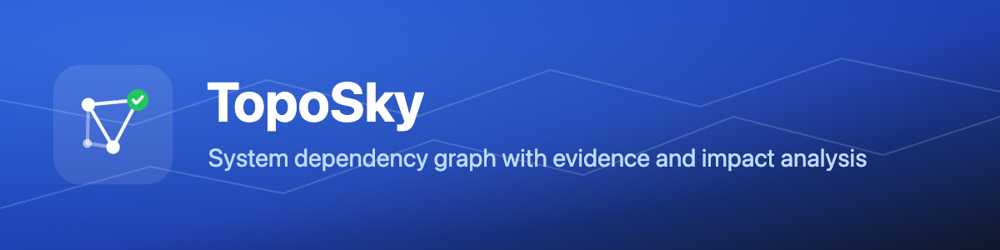

<div align="center">



<p align="center"><strong>English</strong> · <a href="README.zh-CN.md">简体中文</a></p>

[](<https://github.com/skyzhao1223/toposky/actions/workflows/ci.yml>)
[](<LICENSE>)
[](<package.json>)

</div>

TopoSky is a self-hosted tool for maintaining system dependencies. Before changing a service,
you can inspect its upstream and downstream dependencies, find related business flows and teams,
and review the evidence behind those relationships.

**You supply the map.** Maintain nodes and dependencies in JSON, edit supported fields in the UI,
or import a Backstage catalog. Relations can carry evidence references, verdicts and confidence
labels for human review. The public project does not automatically discover your infrastructure,
verify dependencies against source code, or predict failures. Impact results describe reachability
in the supplied metadata, not proof that a change will break a service.

Start with the fictional sample below; no database is required. The current UI is in Chinese,
so the walkthrough includes the labels you will actually see.

## Screenshots

| Overview | System topology |
|---|---|
|  |  |
| **Impact analysis** | **Business process catalog** |
|  |  |

These screenshots use the [fictional sample dataset](<examples/demo/topology.json>), not a real
organisation's infrastructure. Some branding predates the current version.

## Quick start

Use **Node.js 22.18 or newer** and npm. Some scripts import TypeScript directly using Node's native
type stripping; see [the package requirements](<package.json>).

```bash
git clone https://github.com/skyzhao1223/toposky.git
cd toposky
npm install
npm run data:init
npm run dev -- --hostname 127.0.0.1
```

Open <http://127.0.0.1:3000>. `data:init` copies the fictional sample into the default,
gitignored instance directory; it does not overwrite an existing data file. If you already have
instance data or data-path environment variables configured, the server may use those instead.
`npm run data:status` shows the selected source—confirm it before experimenting.

The local development server supports editing; this is not a read-only static demo.

### Production server

```bash
npm run build
npm start -- --hostname 127.0.0.1
```

### Container

For the default Compose mount, initialise the host's `./data` directory first:

```bash
npm run data:init
docker compose up --build
```

The entrypoint initializes fictional sample data only in an empty default `/data` volume; it never
overwrites existing contents or initializes custom explicit paths. Linux bind mounts must allow UID
1001 to write. The current image does not install Git. The npm server commands and Compose host port
are loopback-only by default. Remote deployments still require authentication and HTTPS; do not
expose the app or write endpoints directly. Configuration and deployment details are in
[Engineering](<docs/ENGINEERING.md>), [Architecture](<docs/ARCHITECTURE.md>) and the
[security policy](<SECURITY.md#data-sensitivity>).

A local read-only static demo can also be built; see [demo build instructions](<docs/ENGINEERING.md#演示构建>).
The public demo deployment still needs verification.

## Try it with the sample data

After confirming that you are using the fictional sample, follow this route:

1. **Inspect a dependency.** Open **系统拓扑** (System topology, `/topology`) and locate
   **审批引擎** (Approval engine, node ID `approval-api`). Select a node to inspect its neighbourhood;
   select a relation to see its recorded confidence and evidence. Missing evidence means review is
   still needed, not that the relation has been disproved.
2. **Scope a change.** Open **影响分析** (Impact analysis, `/impact`), choose **审批引擎** in the
   system selector, and keep the depth at **2**. Review upstream/downstream nodes, affected flows,
   processes and owners. These are candidates for investigation and notification, not a failure forecast.
3. **Make a small edit.** Open **元数据** (Metadata, `/metadata`), switch from **字段清单**
   (Field inventory) to **数据编辑** (Data editing), and open **系统节点** (System nodes).
   Change an existing node's **描述** (Description) or **负责人** (Owner), then click **保存** (Save).
4. **Confirm persistence.** Reload the page and check the edited value. Saving writes instance data
   after validation; it does **not** necessarily create a Git commit. The default ignored instance
   directory has no commit audit until you configure a separate data repository.

Other entry points are **总览** (Overview, `/`), **业务流程** (Business processes, `/processes`)
and **资产目录** (Assets, `/assets`). They show different views of the same metadata.

The metadata editor is not a complete graph-authoring interface: relation confidence and evidence
are currently read-only there. To add nodes or dependency relations, or to change evidence, edit
your instance JSON, validate it, then refresh the UI. See [Use your own data](<#use-your-own-data>).

## Use your own data

Keep real topology separate from this code repository. A private directory or private data repository
outside the checkout is a good starting point. Do not put real organisation data in the
[public sample](<examples/demo/topology.json>), screenshots, issues or pull requests.

From the **TopoSky repository root**, initialise a separate directory and start the app with that
same directory selected:

```bash
TOPOLOGY_DATA_DIR=../my-topology-data npm run data:init
TOPOLOGY_DATA_DIR=../my-topology-data npm run validate
TOPOLOGY_DATA_DIR=../my-topology-data npm run dev -- --hostname 127.0.0.1
```

The directory starts with a copy of the fictional sample. Replace it gradually with your own
systems, deployable nodes, relations, owners and business flows. The [data model](<docs/DATA-MODEL.md>)
and [JSON Schema](<topology.schema.json>) describe the structure; the
[governance guide](<docs/GOVERNANCE.md>) explains evidence and review practices.

For dependencies, record a locatable evidence reference and a verdict when available. **`absent`
means “not found by this method”; `refutes` means contradicting evidence was found.** Do not treat
filled fields or high confidence labels as independent verification.

After editing the instance JSON, validate it and inspect the selected source before refreshing:

```bash
TOPOLOGY_DATA_DIR=../my-topology-data npm run validate
TOPOLOGY_DATA_DIR=../my-topology-data npm run data:status
TOPOLOGY_DATA_DIR=../my-topology-data npm run report:quality
```

Backstage users can start from an existing catalog. Import is a dry run unless `--apply` is supplied;
review the mapping and information loss in [Backstage interoperability](<docs/BACKSTAGE.md>) before
applying it to instance data.

### Data-path configuration

`TOPOLOGY_DATA` selects a specific file; otherwise `TOPOLOGY_DATA_DIR` selects the directory containing
`topology.json`. Without either, the default instance location is the gitignored `data/` directory.
When no default instance exists, legacy data or the bundled sample may be used as a read fallback.
An explicitly configured missing path is not a request to fall back to sample data. Missing, corrupt
or structurally invalid data produces an explicit HTTP 503, not a successful empty graph.
Check `data:status` and the selected data file when loading fails.

See [environment settings](<.env.example>) for configuration. **`npm run data:init` does not load
`.env` automatically**, which is why the examples pass the environment variable explicitly to initialization,
validation and server startup.
If `TOPOLOGY_DATA` is already set, it takes precedence over `TOPOLOGY_DATA_DIR`; clear it or make the
settings consistent. Snapshots are stored in a `versions/` subdirectory of the selected instance store.

### Optional Git audit

For commit history, stop the development server with `Ctrl+C`, initialise a separate private Git
repository in the data directory, and make an initial commit. Configure your Git identity first
if it is not already available:

```bash
git -C ../my-topology-data init
git -C ../my-topology-data add -- topology.json
git -C ../my-topology-data commit -m "chore(data): initial topology"
```

Restart with the same `TOPOLOGY_DATA_DIR` and loopback-host command above. For subsequent UI
saves, TopoSky attempts a commit when Git is available and the data file belongs
to a repository and is not ignored. A successful file save is not proof of a successful commit;
check the data repository's history. Commit failure can leave the saved file unaudited.

Version-based conflict checks are conditional: they require a current Git version and a client
base version. They are **not an atomic multi-user editing guarantee**. Snapshot restore is a
separate operation and currently bypasses save validation, version conflict checks and Git commits.
Coordinate writers, keep backups, and validate restored data before relying on it. Read
[Current limitations](<docs/LIMITATIONS.md>) and the [HTTP API](<docs/API.md>) before integrating writes.

## Current limitations

- **Metadata is not live monitoring.** Environment status, versions and health indicators come from
  supplied data or static UI labels, not continuous probes. Freshness depends on your maintenance process.
- **Evidence and impact trust are not fully aligned.** Impact trust uses relation confidence rather
  than the shared evidence verdict interpretation. With multiple paths, the first visited path wins;
  relation order can change a confidence result. Trust totals can also count a node in both directions.
  Treat the displayed tiers as review hints, never a guarantee for change approval.
- **Audit and recovery have conditions.** Default ignored instance data is saved without commit
  history; commit failures, conditional conflict checks and snapshot restore have the limitations
  described above. There is no complete concurrent editing or audited rollback workflow today.
- **Access control is your responsibility.** There is no built-in authentication by default. Protect
  the app and write endpoints before connecting sensitive data or exposing it beyond trusted users.
- **The UI is currently Chinese.** English documentation does not imply an English interface.

See [Known implementation limitations](<docs/LIMITATIONS.md>) for verified behaviour, operational
consequences and workarounds. The [governance guide](<docs/GOVERNANCE.md>) describes review policy;
policy is not a claim that every safeguard is already enforced by code.

## Documentation

| Read next | Purpose |
|---|---|
| [Data model](<docs/DATA-MODEL.md>) | Structure, fields, vocabularies and validation |
| [Governance](<docs/GOVERNANCE.md>) | Evidence semantics, coverage assertions and review practices |
| [HTTP API](<docs/API.md>) | Request/response contracts and write conditions |
| [Known limitations](<docs/LIMITATIONS.md>) | Current implementation gaps and practical precautions |
| [Architecture](<docs/ARCHITECTURE.md>) | Data flow, design decisions and deployment |
| [Engineering](<docs/ENGINEERING.md>) | Commands, code structure and contributor checks |
| [Backstage interoperability](<docs/BACKSTAGE.md>) | Catalog import/export mappings and information loss |
| [Releasing](<docs/RELEASING.md>) | Public export and release checks |

Several deeper guides have Chinese bodies with English summaries. Start with the relevant topic
rather than treating this README as a complete schema or operations manual.

## Contributing

Follow [the contribution guide](<CONTRIBUTING.md>) and [engineering conventions](<AGENTS.md>).
Useful contributions include sample-based bug reproductions, documentation corrections, tests for
known edge cases, and improvements to evidence handling or safe persistence.

Use fictional data in every public report. Report security issues privately following
[the security policy](<SECURITY.md>), not in a public issue. Community conduct is covered by
[the code of conduct](<CODE_OF_CONDUCT.md>); Chinese translations are available for
[contributing](<CONTRIBUTING.zh-CN.md>), [security](<SECURITY.zh-CN.md>) and
[conduct](<CODE_OF_CONDUCT.zh-CN.md>). Issue and pull request templates are currently in Chinese.

### Contributors

- [@skyzhao1223](<https://github.com/skyzhao1223>) — creator and maintainer

## Next priorities

- Align impact trust with evidence verdicts and define deterministic handling of multiple paths and cycles.
- Improve persistence, conflict detection, snapshot restore and commit-failure feedback.
- Add evidence-source integration examples and declared-versus-observed review reports.
- Explore multi-instance views and read-only sharing, complete English technical guides, and verify public demo deployment.

These are directions for further work, not capabilities already available.

## Star history

<a href="https://star-history.com/#skyzhao1223/toposky&Date">
  <picture>
    <source media="(prefers-color-scheme: dark)" srcset="https://api.star-history.com/svg?repos=skyzhao1223/toposky&type=Date&theme=dark" />
    
  </picture>
</a>

## License

Code and fictional demo data are licensed under [Apache-2.0](<LICENSE>). Third-party attribution is
in [NOTICE](<NOTICE>); the [full production dependency inventory](<THIRD_PARTY_NOTICES.md>) includes
transitive and optional platform packages, including EPL, LGPL, Python-2.0 and CC-BY components.
License notices are bundled with distributable images and demos. Real instance data is not part of
this repository; its licensing and handling are the operator's responsibility.
