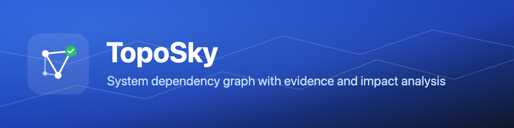
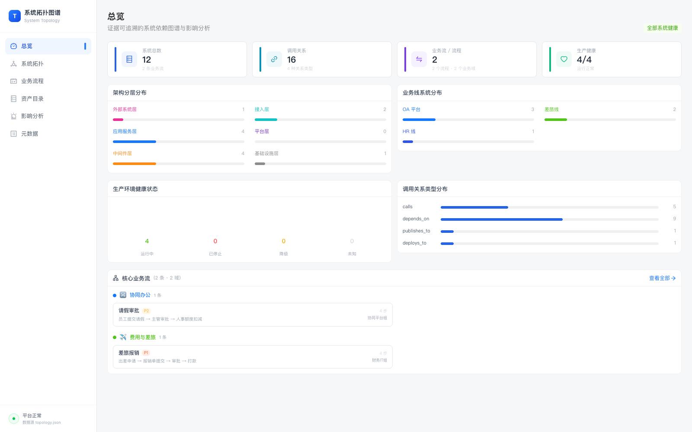
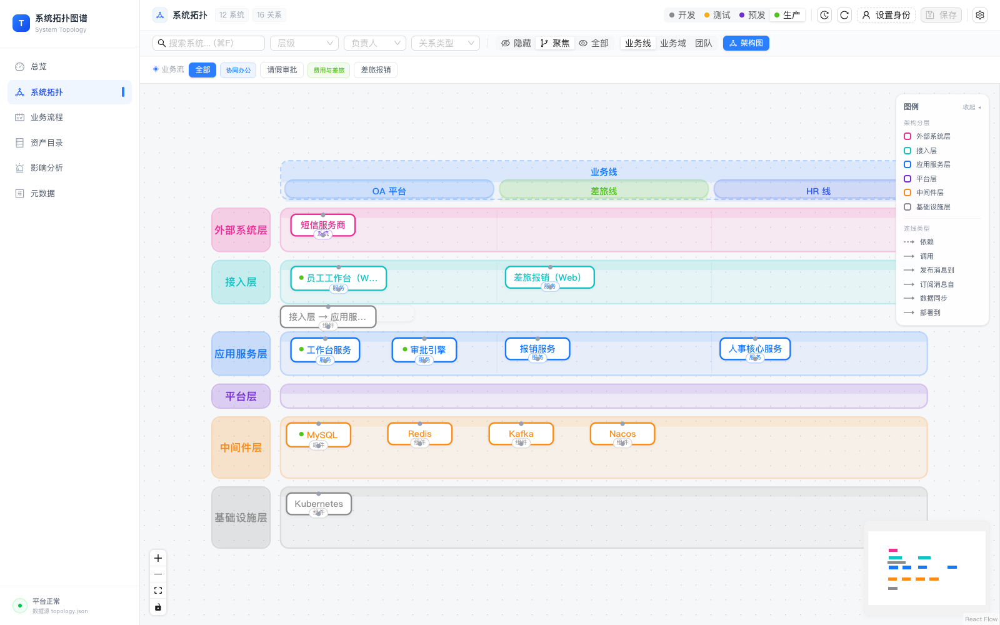
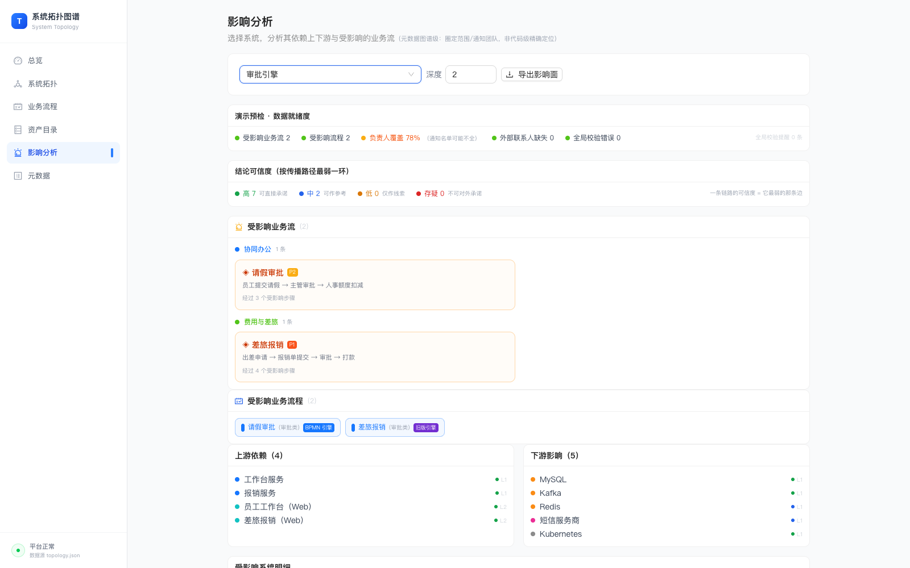
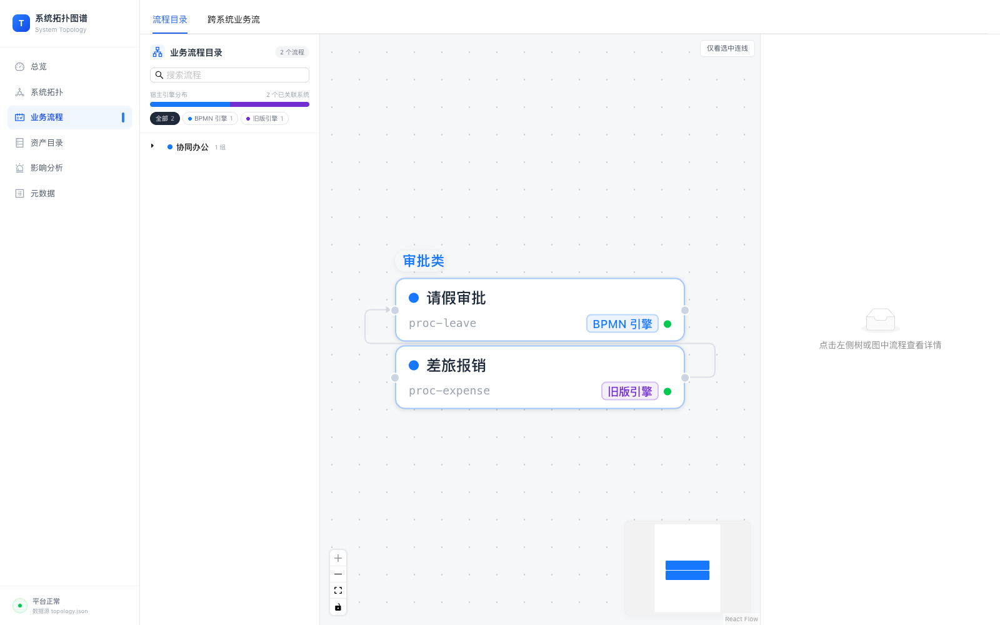

<div align="center">



<p><a href="README.md">English</a> · <strong>简体中文</strong></p>

[](https://github.com/skyzhao1223/toposky/actions/workflows/ci.yml)
[](LICENSE)
[](package.json)

</div>

TopoSky 是一个用于维护系统依赖关系的 Web 工具。修改一个服务前，可以查看它的上下游，整理可能涉及的业务流程、代码仓库和负责人，再检查这些关系的证据来源。

数据保存在 JSON 文件中，不需要数据库。你可以手动维护节点和关系，也可以导入 Backstage 目录；每条关系都支持记录证据出处和核实状态。目前公开版本不提供自动依赖发现或代码核验，影响分析也不预测某次变更是否一定导致故障。

## 截图

| 总览 | 系统拓扑 |
|---|---|
|  |  |
| 影响分析 | 业务流程 |
|  |  |

截图使用仓库自带的[虚构示例数据](examples/demo/topology.json)。界面目前以中文为主；截图中的部分品牌文案来自较早版本。

## 快速开始

需要 **Node 22.18 或更新版本**。校验和报告脚本依赖 Node 原生的 TypeScript 类型剥离。

```bash
git clone https://github.com/skyzhao1223/toposky.git
cd toposky
npm install
npm run data:init
npm run dev -- --hostname 127.0.0.1
```

打开 <http://127.0.0.1:3000>。`data:init` 会把示例复制到 `./data/topology.json`，已有文件不会被覆盖。若目录中已有自己的数据，页面会读取它；用 `npm run data:status` 确认当前数据源，不要把实例数据当成演示数据。

### 生产模式

```bash
npm run build
npm start -- --hostname 127.0.0.1
```

### 容器

以下步骤使用默认的 `./data` 目录。建议先初始化，再启动；容器也会仅在真正为空的默认 `/data` 卷初始化虚构示例，不覆盖已有内容，也不初始化自定义显式路径。Linux 挂载目录需允许 UID 1001 写入。

```bash
npm run data:init
docker compose up --build
```

**应用本身没有登录鉴权。** 默认 npm 服务命令及 Compose 宿主端口仅绑定回环地址；远程接入真实数据前，仍应限制网络访问，并在反向代理层配置认证和 HTTPS。部署要求见[安全说明](SECURITY.zh-CN.md#数据敏感性重要)。当前容器镜像未安装 Git，不能用它验证自动提交审计。

只想预览界面时，也可以构建本地只读静态演示；命令和构建注意事项见[工程文档](docs/ENGINEERING.md#演示构建)。公开演示部署仍需验证。

## 用示例走一遍

完成快速开始后，可以按下面的顺序体验：

1. 打开 **系统拓扑**（`/topology`），找到「审批引擎」（节点 ID：`approval-api`），查看它连接了哪些服务和中间件；点击关系查看记录的证据和可信度。
2. 打开 **影响分析**（`/impact`），选择同一个节点，调整传播深度，查看上下游、业务流程和负责人。这里显示的是图中可达的范围，不是必然故障清单。
3. 打开 **元数据 → 数据编辑 → 系统节点**（`/metadata`），修改一个示例节点的描述或负责人，点击「保存」。
4. 刷新页面，再到 **资产目录**（`/assets`）检查改动已保留。文件保存成功不等于已产生 Git 提交，审计需要另行配置。

元数据页可编辑部分字段，但关系的证据与可信度目前只读。新增节点、系统依赖，或修改 `evidence` / `confidence` 时，需要编辑实例 JSON；先备份，再按[数据模型](docs/DATA-MODEL.md)修改，运行 `npm run validate`，最后刷新页面。不要直接改随仓库发布的示例文件来存放真实数据。

其他页面：**总览**（`/`）汇总登记信息；**业务流程**（`/processes`）展示流程目录和业务流步骤。总览中的环境状态来自元数据，不是实时监控；业务流视图也不执行工作流。

## 接入自己的数据

真实系统名、域名、团队和仓库地址不应提交到代码仓库。实例可以放在已忽略的 `./data`，也可以放到仓库外；版本快照存放在实例目录的 `versions/`。

下面的例子在仓库旁创建你自己的数据目录，不需要访问维护者的私有仓库。请在 TopoSky 根目录执行，且不要同时设置 `TOPOLOGY_DATA`；该变量的优先级高于 `TOPOLOGY_DATA_DIR`。

```bash
TOPOLOGY_DATA_DIR=../my-topology-data npm run data:init
TOPOLOGY_DATA_DIR=../my-topology-data npm run validate
TOPOLOGY_DATA_DIR=../my-topology-data npm run dev -- --hostname 127.0.0.1
```

新目录最初仍是示例数据。按[数据模型](docs/DATA-MODEL.md)逐步替换为自己的节点、关系和流程；每次修改后校验，并备份整个实例目录。如果已有 Backstage 目录，可以[先预览导入结果](docs/BACKSTAGE.md)，确认映射后再加 `--apply` 写入。

路径设置见[环境变量示例](.env.example)。应用会加载 `.env`，但 `npm run data:init` 当前不会；所以上面的初始化命令显式传入了目录。通常只设置一个路径变量，避免数据和快照落在不同位置。

### 可选：为数据启用 Git 审计

停止服务器后，可以把新数据目录初始化为独立的私有 Git 仓库：

```bash
git -C ../my-topology-data init
git -C ../my-topology-data add -- topology.json
git -C ../my-topology-data commit -m "chore(data): initial topology"
```

提交需要本机配置 Git 身份；不要把数据仓库推到公开远端。之后仍用上面的 `TOPOLOGY_DATA_DIR` 启动应用。

页面保存会尝试向数据文件所属仓库提交。默认被忽略的 `./data` 只落盘，不保证有提交历史；没有 Git、提交失败或回滚时，也不能假定审计完整。当前版本号冲突检查依赖 Git 提交记录，不是完整的多人并发写入保护。具体条件与未修复问题见[当前限制](docs/LIMITATIONS.md#saving-git-audit-and-concurrent-edits)。

## 当前限制

在接入真实数据前，请了解以下边界：

- **证据需要维护者核实。** 字段可以缺省，校验器也不会自动查看代码或配置。`absent` 表示按某个方法没找到，`refutes` 才表示有反证；二者不能混用。有反证但仍标为 `high` 的关系，目前只触发告警，不阻断保存。
- **影响可信度尚有实现缺陷。** 当前传播主要按 `confidence` 计算，没有统一使用证据核实状态；多路径结果还可能受关系排列顺序影响。不要把页面或 API 中的「可承诺」条数当作发布安全保证，应逐条复核关系和证据。
- **保存、审计和回滚不是同一套完整事务。** 默认数据目录不自动产生 Git 提交；提交反馈和回滚路径也有已知问题。多人操作前先备份，避免同时编辑。
- **显式路径缺失不会回退示例。** 缺失、损坏或结构不合法的数据返回 503，而不是成功空图。遇到加载错误，应运行 `npm run data:status` 并检查数据文件，不要用空图覆盖实例。

[限制与后续修复清单](docs/LIMITATIONS.md)记录了具体行为、源码位置及处理建议。上述实现问题尚未修复。

## 深入文档

| 想了解什么 | 文档 |
|---|---|
| 字段、关系方向、证据状态和示例 | [数据模型](docs/DATA-MODEL.md) · [JSON Schema](topology.schema.json) |
| 接口参数、保存协议和响应结构 | [HTTP API（英文）](docs/API.md) |
| 数据如何核实、怎样区分线索和反证 | [数据治理](docs/GOVERNANCE.md) |
| Backstage 导入导出及信息损失 | [Backstage 互通](docs/BACKSTAGE.md) |
| 开发命令、部署与目录约定 | [工程文档](docs/ENGINEERING.md) · [架构说明](docs/ARCHITECTURE.md) |
| 已知问题和使用边界 | [当前限制（英文）](docs/LIMITATIONS.md) |

## 贡献

问题和需求可以提交到 [Issues](https://github.com/skyzhao1223/toposky/issues)，使用讨论见 [Discussions](https://github.com/skyzhao1223/toposky/discussions)。复现时使用虚构数据，不要上传真实拓扑、凭证或内部地址。

改动前请读[贡献指南](CONTRIBUTING.zh-CN.md)；安全问题按[安全说明](SECURITY.zh-CN.md)私下报告。社区文档已有中英文版本，现有专题文档多数仍以中文正文和英文摘要提供。

### 贡献者

- [@skyzhao1223](https://github.com/skyzhao1223) — 项目发起与维护

## 后续优先事项

- 统一证据与影响可信度口径，处理多路径和循环统计。
- 补齐保存、回滚、冲突检测和审计失败反馈。
- 增加自动采集接入示例及「登记关系与观测结果」的差异报告。
- 探索多实例和只读分享，补全英文专题文档，并验证公开演示部署。

以上是待推进的方向，不代表这些能力已经可用。

## Star 历史

<a href="https://star-history.com/#skyzhao1223/toposky&Date">
  <picture>
    <source media="(prefers-color-scheme: dark)" srcset="https://api.star-history.com/svg?repos=skyzhao1223/toposky&type=Date&theme=dark" />
    
  </picture>
</a>

## 许可证

代码与虚构示例数据采用 [Apache-2.0](LICENSE)。第三方署名见 [NOTICE](NOTICE)，[完整生产依赖清单](THIRD_PARTY_NOTICES.md)包含传递依赖与平台可选包，包括 EPL、LGPL、Python-2.0 和 CC-BY 组件；镜像和静态演示会附带许可声明。真实实例数据的授权由部署方决定，不随代码仓库发布。
